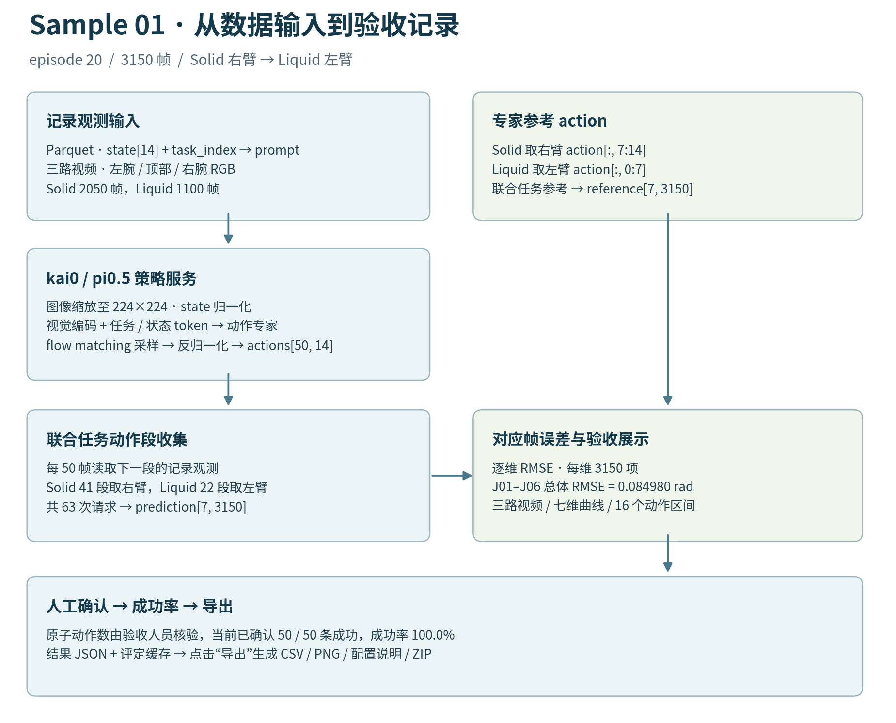
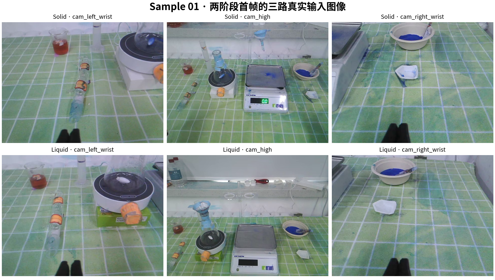
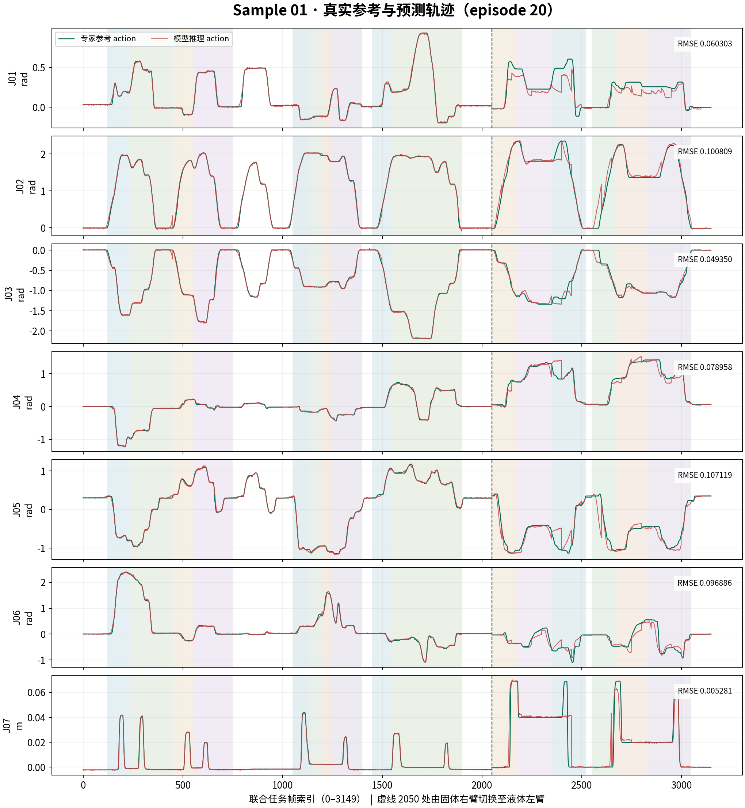

# 固液联合任务验收流程说明

## 1. 示例与验收目标

本文以验收 UI 的第一条数据 **SAMPLE 01** 为例，说明固体采集任务＋液体采集联合任务数据如何进入模型、形成动作轨迹、计算误差并完成评定。示例数据与数值读取于 2026 年 11 月 20 日。

| 项目 | 当前示例 |
| --- | --- |
| 页面位置 | SAMPLE 01，本批次第 1 条 |
| 原始数据编号 | episode 20，界面显示“第 20 条” |
| 联合任务 | 固体采集任务＋液体采集任务 |
| 时序长度 | 3150 帧，采样率 30 Hz |
| 展示时长 | 105 秒，最后一个采样时刻为 3149 / 30 = 104.966667 秒 |
| 模型输入 | 三路 RGB 图像、14 维机器人观测状态、任务文本 |
| 展示输出 | 7 维动作轨迹，形状 [7, 3150] |
| 整体 RMSE | **0.084980449407 rad < 0.1 rad** |
| 人工评定 | 本条数据 RMSE<0.1, 且生成了复核测试方案中要求的>=12 个原子动作, 因此本条样本判定为成功|


## 2. 输入到输出的整体数据流



图 1 根据当前服务实现绘制。进入页面后，前端从 `/api/samples` 获取固定名单、采样率、摄像头与原子动作区间，再读取 `/api/samples/20` 获取专家参考动作。点击“开始推理”后，后端按名单依次读取记录观测，通过 WebSocket 请求 Solid（固体采集） 与 Liquid（液体采集）策略服务，收集模型输出并计算 RMSE。前端轮询推理状态，读取 `/api/inference/20`，显示红色预测曲线和各项误差。

数据在流程中有三种用途。三路图像、观测状态和任务文本构成策略输入。数据集的 `action` 字段提供对应时刻的专家参考值，参与后续误差计算。人工原子动作模板给 UI 提供彩色区间、动作名称和解释，支持验收人员复核动作流程。

## 3. kai0 模型及本项目使用方式

### 3.1 VLA 与 kai0

VLA 是 Vision-Language-Action，即视觉—语言—动作模型。模型结合摄像头图像中的物体与场景、自然语言任务指令、机器人的当前状态，预测一段未来动作。对本项目而言，可概括为 `三路图像 + state[14] + prompt → actions[50, 14]`。返回数组每一行对应一个未来时刻，每行包含左臂和右臂各 6 个关节及 1 个夹爪值。当前部署配置使用π₀.₅ 策略。

kai0，论文记作 χ₀，是 OpenDriveLab 开源的机器人操作框架，基于 Physical Intelligence 的 openpi 与 π₀／π₀.₅ 模型构建。官方工作围绕长程操作中的分布一致性，提供 Model Arithmetic、Stage Advantage 和 Train-Deploy Alignment 三类能力。它们分别涉及模型权重融合、阶段感知优势信号及优势加权行为克隆训练，以及数据增强、纠正采集和部署推理。上述内容用于理解模型来源和训练方法，本验收流程加载已经训练好的策略检查点执行推理。[kai0 官方仓库](https://github.com/OpenDriveLab/kai0)


### 3.2 单次请求时模型内部的数据处理

1. **构造观测。** 验收后端读取目标帧的 `observation.state`，转换为 float32；解码对应三路 RGB 视频帧，将图像组织为 `[3, H, W]` 的 uint8 数组。
2. **适配与归一化。** 
3. **视觉与语言编码。** 图像预处理，并对任务与状态共同编码为文本 token，并结合三路图像的视觉 token 构成条件信息。
4. **动作生成与输出。** 视觉语言骨干处理条件信息，动作专家通过 flow matching 从噪声动作段预测连续动作。通俗地说，模型根据“看到了什么、要完成什么、机械臂当前在哪里”，将候选动作调整为符合任务的一段动作序列，并执行去噪。进行反归一化，输出动作。


## 4. Sample 01 的真实输入与输出

### 4.1 数据文件与输入字段

输入数据为 LeRobot 格式数据。Sample 01 对应两套数据中的 episode 20。其共包含 **3150 个采样点**，其中固体采集阶段 2050 个、液体采集阶段 1100 个，采样频率均为 30 Hz，相邻采样点约相隔 0.033333 秒。每个 Parquet 文件的一个采样点，包含该时刻的机器人状态、参考动作与索引信息和三路摄像头图像由同一时刻的视频帧提供。这些共同作为了模型推理时的输入。



例如固体采集阶段第 0 帧，实际发送的状态与任务字段可表示为以下内容。数值为便于阅读保留 9 位小数，图像字段以形状说明。

```python
payload = {
    "state": [
        -0.010553620, -0.008669668, -0.001726956,
        -0.015141392,  0.346298277,  0.033318039,
        -0.000350000,  0.031399202, -0.000872200,
         0.003977232,  0.000000000,  0.301659077,
         0.005878628, -0.002240000
    ],
    "images": {
        "hand_left":  "uint8 array [3, H, W]",
        "top_head":   "uint8 array [3, H, W]",
        "hand_right": "uint8 array [3, H, W]"
    },
    "prompt": "scoop_solid_to_weighing_boat"
}
```

### 4.2 动作段如何形成完整联合任务轨迹

当前策略一次返回 50 帧动作，约覆盖 50 / 30 = 1.666667 秒。验收后端采用本段动作后，从下一段起点读取记录观测继续请求模型。按照当前配置，固体阶段需要 2050 / 50 = 41 次请求，液体阶段需要 1100 / 50 = 22 次请求，合计 63 次。这是按配置与长度计算的请求次数。

例如固体阶段的请求起点依次为 0、50、100、…、2000，液体阶段的局部请求起点依次为 0、50、100、…、1050。后端检查每次返回的动作数组维度为 `[horizon, 14]` 且数值有限，并将每段保留长度限制在当前任务剩余帧数内。

这项测试基于记录观测开展离线轨迹评估。下一段输入来自数据集对应时刻的状态和图像。模型输出经活动臂维度选择，按联合任务时序组织为 7×3150 的预测数组，与同形状的专家参考数组逐点比较。J01–J07 表示对应阶段活动臂的同类维度。

Sample 01 当前保存结果中的首个 7 维预测值为以下内容，对应固体采集阶段右臂，单位依次为 6 个 rad 与 1 个 m。

```text
prediction[:, 0] = [0.028221815, -0.008006940, 0.012915674, 0.008667023, 0.310983878, -0.000219968, -0.002615882]
```

七维展示依次为 `waist`、`shoulder`、`elbow`、`forearm_roll`、`wrist_angle`、`wrist_rotate`、`gripper`。前六项按 rad 展示，J07 夹爪按 UI 口径使用 m。绿色参考曲线读取数据集 `action`，红色曲线读取模型结果 `prediction`。



图 3 使用当前服务返回的完整预测与参考数组重绘。竖向虚线标出两个任务阶段的分界，彩色区间与 UI 的原子动作模板一致，七个子图右上角列出对应维度的 RMSE。


## 5. RMSE 公式与实际数值演算

### 5.1 RMSE 的含义与评价方式

RMSE 是 Root Mean Square Error，即均方根误差。它先计算每个对应采样点的预测值与参考值之差，将误差平方后求平均，再开平方，得到与原始数据单位一致的误差指标。平方运算使正负误差都贡献于统计结果，也使较大的偏差对指标产生更大的影响。

在本测试中，RMSE 用于衡量模型推理动作轨迹与专家参考动作轨迹的拟合程度。在相同数据、采样点对齐方式和动作维度下，**RMSE 越小，表示两条轨迹的整体偏差越小、拟合越好；RMSE 越大，表示整体偏差越大、拟合越差**。RMSE 为 0 表示参与计算的所有对应数值完全一致。

UI 分别报告七个动作维度的 RMSE，并以 J01–J06 六个关节的整体 RMSE 作为本次验收的误差判据，要求严格小于 0.1 rad。Sample 01 的整体 RMSE 为 0.084980449407 rad，因此符合该误差要求。整体 RMSE 汇总了全部采样点的偏差，各时刻的局部拟合情况还可结合轨迹曲线查看；原子动作数按第 7 部分进行复核。

### 5.2 评价公式

设 `y[j,t]` 为专家参考 action，`ŷ[j,t]` 为模型预测 action，`j` 为动作维度，`t=0,…,3149` 为联合任务采样点。先计算每一维的 RMSE，再计算 J01–J06 六项 RMSE 的均方根。

逐维 RMSE 为

$$
r_j=\sqrt{\frac{1}{N}\sum_{t=0}^{N-1}\left(\hat{y}_{j,t}-y_{j,t}\right)^2},\qquad N=3150
$$

六关节整体 RMSE 为

$$
R=\sqrt{\frac{1}{6}\sum_{j=1}^{6}r_j^2}=\sqrt{\frac{1}{6N}\sum_{j=1}^{6}\sum_{t=0}^{N-1}\left(\hat{y}_{j,t}-y_{j,t}\right)^2}
$$

第一式对每一维的 3150 个误差平方取均值后开平方。第二式对六个关节等权汇总，等价于直接对 6×3150 = 18900 个关节误差平方求均值并开平方。夹爪 J07 使用 m，单独报告。整体指标单位为 rad，与界面中的整体 RMSE 定义一致。

### 5.3 J01 的真实采样点代入

以下数值直接取自 Sample 01 当前预测与参考数组。

| 帧 t | 参考 y（rad） | 预测 ŷ（rad） | 误差 ŷ−y（rad） | 误差平方（rad²） |
| --- | --- | --- | --- | --- |
| 0 | 0.031399201602 | 0.028221814609 | -0.003177386993 | 1.00957881036e-05 |
| 1 | 0.031399201602 | 0.031857846631 | 0.000458645029 | 2.10355262461e-07 |
| 2 | 0.031399201602 | 0.027387258414 | -0.004011943188 | 1.60956881403e-05 |
| 2050 | -0.021264236420 | -0.024308336897 | -0.003044100476 | 9.26654771098e-06 |
| 3149 | -0.005058759823 | -0.004130072486 | 0.000928687338 | 8.62460171205e-07 |

第 0 帧误差为 `0.028221814609 − 0.031399201602 ≈ −0.003177386993 rad`，其平方约为 `0.000010095788104 rad²`。沿所有帧执行同样的运算，再求和、除以 3150 并开平方。

```text
J01 的误差平方和
  = (0.028221814609 - 0.031399201602)²
  + (0.031857846631 - 0.031399201602)²
  + (0.027387258414 - 0.031399201602)²
  + ...
  + (-0.004130072486 - (-0.005058759823))²
  = 11.454948581595 rad²

J01 RMSE
  = sqrt(11.454948581595 / 3150)
  = sqrt(0.003636491613)
  = 0.060303330034 rad
```

省略号涵盖其余采样点。公式展示的输入做了四舍五入，误差平方和及最终结果使用原始完整精度数组计算。

### 5.4 七维统计及整体指标代入

| 维度 | 名称 | 3150 项误差平方和 | 逐维 RMSE | RMSE 单位 |
| --- | --- | --- | --- | --- |
| J01 | waist | 11.454948581595 | 0.060303330034 | rad |
| J02 | shoulder | 32.011809433243 | 0.100809122529 | rad |
| J03 | elbow | 7.671655975205 | 0.049350241553 | rad |
| J04 | forearm_roll | 19.638246666859 | 0.078957988964 | rad |
| J05 | wrist_angle | 36.144328216852 | 0.107118578735 | rad |
| J06 | wrist_rotate | 29.568702295659 | 0.096885961923 | rad |
| J07 | gripper | 0.087851687170 | 0.005281043883 | m |

前六行误差平方和的单位为 rad²，J07 行为 m²。将前六项 RMSE 代入整体公式，得到以下结果。

```text
整体 RMSE
  = sqrt((0.060303330034² + 0.100809122529²
        + 0.049350241553² + 0.078957988964²
        + 0.107118578735² + 0.096885961923²) / 6)
  = sqrt(0.007221676781)
  = 0.084980449407 rad
  < 0.1 rad
```

本次验收按整体 RMSE 判定。Sample 01 的 J02 与 J05 单维 RMSE 分别约为 0.100809 和 0.107119 rad，界面同时展示这些逐维数据，便于进一步复核轨迹。

以下为与后端定义一致的 NumPy 计算片段。

```python
prediction = np.asarray(result["prediction"], dtype=float)
reference = np.asarray(trajectory["reference"], dtype=float)
# prediction.shape == reference.shape == (7, 3150)
rmse = np.sqrt(np.mean((prediction - reference) ** 2, axis=1))
overall = float(np.sqrt(np.mean(rmse[:6] ** 2)))
```

## 6. 原子动作复核与成功率计算

当前模型执行的原子动作如下，共有固体采集 10 个、液体采集 6 个，合计 16 个。

| 编号 | 所属任务 | 原子动作 | 
| --- | --- | --- | 
| 01 | 固体采集 | 夹取漏斗 | 
| 02 | 固体采集 | 放置漏斗至反应锥 | 
| 03 | 固体采集 | 夹取称量舟 |
| 04 | 固体采集 | 放置称量舟至天平 | 
| 05 | 固体采集 | 夹取称量勺 | 
| 06 | 固体采集 | 舀取固体 | 
| 07 | 固体采集 | 倾倒固体至称量舟 | 
| 08 | 固体采集 | 放置称量勺 |
| 09 | 固体采集 | 夹取称量舟 | 
| 10 | 固体采集 | 倾倒固体至反应锥 | 
| 11 | 液体采集 | 夹取烧杯 | 
| 12 | 液体采集 | 倾倒溶液至量筒 |
| 13 | 液体采集 | 放置烧杯 | 
| 14 | 液体采集 | 夹取量筒 | 
| 15 | 液体采集 | 倾倒溶液至反应锥 |
| 16 | 液体采集 | 放置量筒 |

Sample 01 的成功结论依据为整体 RMSE `0.084980449407 rad < 0.1 rad`，以及生成的原子动作数达标。

## 7. 总结：完整测试流程

1. **准备数据和模型服务。** 确认固定名单及联合任务数据可读，启动 8002 的 Solid 与 8001 的 Liquid 策略服务，加载指定检查点及其归一化统计。
2. **启动并打开验收 UI。** 运行 `app.py`，访问 8092。页面载入固定 50 条名单，选择 SAMPLE 01，读取三路视频、参考轨迹和原子动作区间。
3. **执行推理。** 点击“开始推理”，后端从数据集读取三路观测、状态与任务文本，按段调用策略服务，收集联合任务动作预测。
4. **计算并展示误差。** 后端按相同采样点与动作维度比较 `prediction` 与 `reference`，计算七项逐维 RMSE 及六关节整体 RMSE。前端显示预测曲线、参考曲线、各项误差和完成状态。
5. **完成验收评定。** 验收人员复核动作流程和数量，并按整体 RMSE 阈值逐条确认结果。页面由已确认记录计算成功条数和成功率。
6. **导出结果。** 点击“导出”，服务生成带时间戳的验收结果目录与 ZIP，包含 `samples.csv`、`batch_summary.json`、完整预测 JSON、七维轨迹 PNG、评定结果、异常记录和配置说明。服务执行文件 SHA-256、图片解码和 ZIP 完整性核验。
