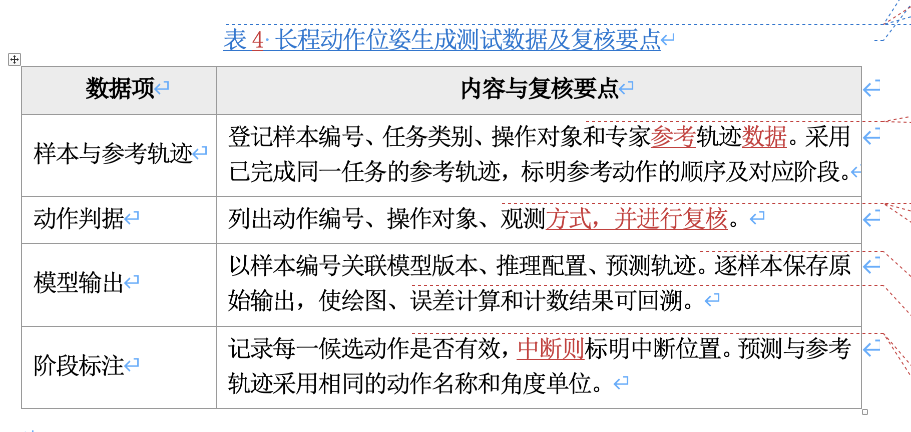
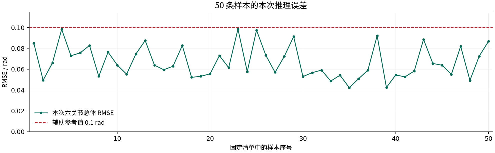

# 指标 3.2 长程动作生成测试报告草稿

- 草稿状态：数值复核与送测方人工核验确认已纳入，供验收人员复核、签署。
- `材料说明.md`中对当前提交内容中的材料做了解读, 作为文件清单索引.

## 一、测试依据与判定要求

依据《附件1-项目里程碑测试方案-课题三》指标 3.2，测试样本总数应不少于 20，覆盖固体称量和液体称量，且每条样本的最长连续有效原子动作数 Lᵢ 均不少于 12。动作有效性须符合预定义语义，相邻动作须满足状态衔接条件。关节角 RMSE值应当小于 0.1 rad。

## 二、测试对象与方法

测试对象为长程动作位姿生成模块。加载好的用于推理的模型后，使用验收界面进行验收。每条联合样本由同编号固体右臂 2050 帧和液体左臂 1100 帧组成，共 3150 帧、30 Hz、105 秒；共测试 50 组样本。

模型接收三路记录图像、14 维状态和任务文本，按动作段生成预测，输出七维轨迹。每段起点采用数据集观测。按相同帧索引和同名关节对齐预测与参考 action，分别计算七个关节的RMSE，并汇总前六个关节。

RMSE 是 Root Mean Square Error，即均方根误差。它先计算每个对应采样点的预测值与参考值之差，将误差平方后求平均，再开平方，得到与原始数据单位一致的误差指标。平方运算使正负误差都贡献于统计结果，也使较大的偏差对指标产生更大的影响。

在本测试中，RMSE 用于衡量模型推理动作轨迹与专家参考动作轨迹的拟合程度。在相同数据、采样点对齐方式和动作维度下，**RMSE 越小，表示两条轨迹的整体偏差越小、拟合越好；RMSE 越大，表示整体偏差越大、拟合越差**。RMSE 为 0 表示参与计算的所有对应数值完全一致。

验收后导出了七个动作维度的 RMSE，并以 J01–J06 六个关节的整体 RMSE 作为本次验收的误差判据，要求严格小于 0.1 rad。Sample 01 的整体 RMSE 为 0.084980449407 rad，因此符合该误差要求。整体 RMSE 汇总了全部采样点的偏差，各时刻的局部拟合情况还可结合轨迹曲线查看。一下给出每条样本的六关节整体RMSE计算公式：

设 `y[j,t]` 为专家参考 action，`ŷ[j,t]` 为模型预测 action，`j` 为动作维度，`t=0,…,3149` 为联合任务采样点。先计算每一维的 RMSE，再计算 J01–J06 六项 RMSE 的均方根。

$$
R=\sqrt{\frac{1}{6N}\sum_{j=1}^{6}\sum_{t=0}^{N-1}\left(\hat{y}_{j,t}-y_{j,t}\right)^2}
$$

式中 qᵖ、qʳ 分别为预测和参考关节角，j=1…6。Rᵢ 单位为 rad，夹爪误差以 m 单独报告。

本次核验结果中，50条样本均满足当次总体 RMSE < 0.1 rad。

## 三、本次实测结果

运行编号为 20261120_202638_15dc8f，创建于 2026-11-20T20:26:38+08:00，导出于 2026-11-20T22:28:38+08:00。

本表对照方案表 4“长程动作位姿生成测试数据及复核要点”（如下图)，按四个数据项逐条列示。文件链接均相对于本报告目录，可随整个材料文件夹一同复制。CSV 按列名定位，JSON 按字段路径定位。
，

样本编号示例统一采用 SAMPLE 01（原始第 20 条）。以下“送测方确认”对应本次补充人工核验记录，检方的独立观测依据和签署状态在对应行说明。

| 数据项 | 内容与复核要点 | 对应的文件 | 结论 |
| --- | --- | --- | --- |
| 样本与参考轨迹 | 登记样本编号及展示顺序。 | [samples.csv](导出材料/20261120_222755_525540_验收结果/samples.csv) 的 `sample_id`、`source_item`、`original_episode` 列 | 共 50 条，展示序号与原始条目编号可逐条对应；SAMPLE 01 对应第 20 条。 |
| 样本与参考轨迹 | 登记任务类别及操作对象。 | [有效动作判据.csv](导出材料/20261120_222755_525540_验收结果/有效动作判据.csv) 的“任务”“动作名称”“描述”列。 | 动作描述明确了任务类型，并列明漏斗、反应锥、称量舟、天平、称量勺、烧杯、量筒等对象。 |
| 样本与参考轨迹 | 提供同任务的专家参考轨迹数据。 | [参考轨迹/](附件/参考轨迹) 中 `episode_XXXXXX.json` ；结合 [samples.csv](导出材料/20261120_222755_525540_验收结果/samples.csv) 的 `original_episode` 定位。 | 保留 50 份同编号参考轨迹，每份 reference 为 [7, 3150]；可与预测值逐点比较。[参考视频索引.csv](附件/参考视频索引.csv) 提供三路参考视频的原服务器路径，可据视频复核任务完成情况。视频文件未随本目录提供。 |
| 样本与参考轨迹 | 参考动作顺序及对应阶段。 | [有效动作判据.csv](导出材料/20261120_222755_525540_验收结果/有效动作判据.csv) | 动作 01–10 属于固体阶段，11–16 属于液体阶段。 |
| 动作判据 | 动作编号、名称、操作对象、观测方式。 | [有效动作判据.csv](导出材料/20261120_222755_525540_验收结果/有效动作判据.csv) | 共 16 个动作，按编号给出统一语义。可逐动作查到夹取、放置、舀取、倾倒等操作及目标对象。 |
| 模型输出 | 模型版本 | [samples.csv](导出材料/20261120_222755_525540_验收结果/samples.csv) 的 `sample_id`、`original_episode`、`solid_model_version`、`liquid_model_version` 列。 | 本批使用 solid_awbc_99999 和 liquid_awbc_119999，逐样本可查。 |
| 模型输出 | 登记推理服务器、环境和启动配置 | [推理配置.json](导出材料/20261120_222755_525540_验收结果/推理配置.json) 的 `host`、`cpu`、`memory`、`gpu`、`driver`、`os`、软件版本及 `solid_command`、`liquid_command`。 | 记录 3090 服务器地址、双 RTX 3090 Ti 配置、环境版本、策略配置和检查点路径。 |
| 模型输出 | 保存逐样本预测轨迹数值。 | [results/](导出材料/20261120_222755_525540_验收结果/results) 中 `episode_XXXXXX.json` 的 `prediction`；以 [samples.csv](导出材料/20261120_222755_525540_验收结果/samples.csv) 的 `original_episode` 定位文件名。 | 保留 50 份用于本指标的七维完整预测数组，每份为[7, 3150]数值输出。 |
| 模型输出 | 逐样本波形图并关联数值结果 | [plots/](导出材料/20261120_222755_525540_验收结果/plots) 中 `sample_XXX.png`；[逐样本结果及连续动作复核表.csv](附件/逐样本结果及连续动作复核表.csv) 的“波形图”列；[samples.csv](导出材料/20261120_222755_525540_验收结果/samples.csv) 的 `sample_id`、`original_episode` 列。 | 50 张图按样本展示顺序编号，绿色为参考、红色为预测，可追溯到同一条目的数值 JSON。 |
| 模型输出 | 核对采样点数量和轨迹对齐方法。 | [samples.csv](导出材料/20261120_222755_525540_验收结果/samples.csv) 的 `paired_points_solid`、`paired_points_liquid`、`paired_points_total`；[轨迹对齐方法.txt](导出材料/20261120_222755_525540_验收结果/轨迹对齐方法.txt)。 | 每条 2050+1100=3150 点，30 Hz、105 秒；按同名关节、相同帧索引比较。 |
| 模型输出 | 核对六关节总体 RMSE。 | [samples.csv](导出材料/20261120_222755_525540_验收结果/samples.csv) 的 `six_joint_rmse_rad` 列；逐样本结果 JSON 的 `overall`；[导出文件说明.md](导出材料/20261120_222755_525540_验收结果/导出文件说明.md) 的总体公式。 | 50 条均严格小于 0.1 rad；最小 0.042245、平均 0.066800、最大 0.098529 rad。该列汇总全部六关节及 3150 个采样点。 |
| 模型输出 | 核对 J01–J06 六个关节及 J07 爪夹的逐维 RMSE。 | [samples.csv](导出材料/20261120_222755_525540_验收结果/samples.csv) 的 `J01_rmse_rad`–`J06_rmse_rad`、`J07_rmse_m` 列；逐样本结果 JSON 的 `rmse[0]`–`rmse[6]`，按相同顺序对应。 | 保存全部 50 条样本的七项误差，关节单位为 rad，爪夹单位为 m。SAMPLE 01 的六关节误差依次为 0.060303、0.100809、0.049350、0.078958、0.107119、0.096886 rad，爪夹误差为 0.005281 m；六关节总体 RMSE 另列。 |
| 模型输出 | 支持误差计算复核。 | [results/](导出材料/20261120_222755_525540_验收结果/results) 的 `prediction`、`rmse`、`overall`；[参考轨迹/](附件/参考轨迹) 的 `reference`；[导出文件说明.md](导出材料/20261120_222755_525540_验收结果/导出文件说明.md)、[轨迹对齐方法.txt](导出材料/20261120_222755_525540_验收结果/轨迹对齐方法.txt)。 | 预测值、参考值及公式均可定位，检方可独立复算逐关节及总体 RMSE。 |
| 模型输出 | 保存连续动作计数结果。 | [连续片段统计.csv](附件/连续片段统计.csv) 的“动作数”“最长连续动作数_Li”；[逐样本结果及连续动作复核表.csv](附件/逐样本结果及连续动作复核表.csv) 的“最长连续有效动作数_Li”。 | 50 条最长连续有效动作数均登记为 16；最小 Lᵢ=16，满足 Lᵢ≥12，来源为送测方补充确认。 |
| 模型输出 | 保存逐样本达标标记。 | [连续片段统计.csv](附件/连续片段统计.csv) 的“达标标记_Di”；[逐样本结果及连续动作复核表.csv](附件/逐样本结果及连续动作复核表.csv) 的“Li是否大于等于12”。 | 50 条 Dᵢ 均为 1，对应 50/50 达到连续动作数量要求。 |
| 模型输出 | 保存推理完成状态和整条样本评定。 | [samples.csv](导出材料/20261120_222755_525540_验收结果/samples.csv) 的 `inference_status`、`review_result`、`review_confirmed`；[batch_summary.json](导出材料/20261120_222755_525540_验收结果/batch_summary.json) 的 `completed_count`、`confirmed_count`、`success_count`、`success_rate`。 | 50 条均为 completed、success 且已确认；完成数、确认数、成功数均为 50，成功率 100%。 |
| 阶段标注 | 记录每个候选动作是否有效。 | [逐动作有效性记录.csv](附件/逐动作有效性记录.csv) 的“样本序号”“原始条目编号”“动作编号”“是否有效”“确认来源”|50 条样本各 16 个动作均登记为“是”，按送测方补充确认展开。 |
| 阶段标注 | 记录中断位置及原因。 | [逐样本结果及连续动作复核表.csv](附件/逐样本结果及连续动作复核表.csv) 的“中断位置及原因”；[异常记录.json](导出材料/20261120_222755_525540_验收结果/异常记录.json) 的 `records`。 | 50 条中断栏均为“无（按送测方确认）”；异常 records 为空，即本批无已登记异常事件。 |
| 阶段标注 | 核对预测与参考采用相同的动作名称。 | [plots/](导出材料/20261120_222755_525540_验收结果/plots) 的编号及图例。 | 预测与参考曲线共用同一套动作编号、名称和区间标注，便于逐项定位。 |
| 阶段标注 | 核对预测与参考的维度顺序和角度单位。 | [导出文件说明.md](导出材料/20261120_222755_525540_验收结果/导出文件说明.md) 的 J01–J07 对照表；[轨迹对齐方法.txt](导出材料/20261120_222755_525540_验收结果/轨迹对齐方法.txt)；[results/](导出材料/20261120_222755_525540_验收结果/results) 的 `prediction` 与 [参考轨迹/](附件/参考轨迹) 的 `reference`。 | 两类数组均按腰、肩、肘、前臂旋转、腕俯仰、腕旋转、爪夹排列；前六维为 rad，爪夹为 m。 |

本次结果表明，50 条样本均完成两阶段动作轨迹生成，总体轨迹偏差符合 0.1 rad 的辅助参考条件，且均有人工成功确认。送测方补充确认每条样本的动作 01–16 均有效且连续，Lᵢ 均为 16；附件按该确认和动作模板展开逐动作记录。

SAMPLE 01 对应第 20 条，总体 RMSE 为 0.084980 rad。其 J02、J05 单维 RMSE 分别为 0.100809、0.107119 rad，表明总体阈值与单关节阈值应分别理解。波形图见附件图片及原导出 plots/sample_001.png。

## 四、原子动作与连续性复核

送测方于 2026 年 11 月 20 日补充确认，50 条样本的动作均有效，最长连续有效动作数均为 16。每条样本中相邻动作衔接成立，片段内无中断，模板中的动作间隔保留。因此，每条 Lᵢ=16、Dᵢ=1，50 条均满足不少于 12 个连续有效原子动作的要求。

附件提供 800 条逐动作有效性记录、50 条样本连续片段统计及确认原文。这些记录依据送测方本次确认展开，验收方可逐项核对轨迹、视频及判据，并填写独立观测依据与复核人。另附 50 条数值参考轨迹和原视频路径索引，供复算与查阅。

## 五、结论草稿

本次测试共 50 条联合样本，覆盖固体称量和液体称量，样本数满足不少于 20 的要求。按送测方补充人工确认，50 条样本的最长连续有效原子动作数均为 16，最小值 16≥12，达标标记全部为 1。全部样本总体 RMSE 小于 0.1 rad，平均为 0.066800 rad，支持轨迹拟合质量判断。

依据本次数值复核和补充人工确认，按所提供验收方案的样本量、任务覆盖及连续有效动作数判据，指标 3.2 的报告草稿结论为通过，提交验收方复核签署。
